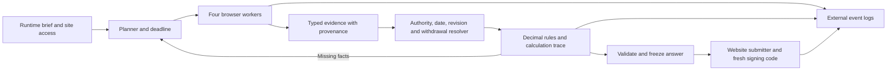

# The Last Team: RFQ agent

Four model-driven browser workers gather tender, specification, ERP and mailbox
evidence. A deterministic resolver and Decimal calculator build a bid; a browser
submitter fills the tender website and signs with a fresh mailbox code. Site
addresses, credentials, task identifiers and business values come from the run.



Only `my-agent/` ships. It extends the supplied starter and uses Python 3.12,
uv, Playwright CDP, Pydantic and Qwen. The root contains development scripts,
synthetic tests and build documentation. The model is chosen by configuration
through one client interface; the default is the hosted Qwen model.
[PROGRESS.md](PROGRESS.md) records the latest completed gate;
[ARCHITECTURE.md](ARCHITECTURE.md) defines interfaces and evaluation limits.

Install dependencies and Chromium from `my-agent/` using `uv sync --frozen`
and `uv run playwright install chromium`. Start the already authenticated
Atira CLI's `atira models proxy` for local model access. From the repository
root, `python scripts/run_local.py --dry` checks runtime configuration,
`python scripts/run_local.py --orient` verifies browser access, and
`python scripts/run_local.py` runs the complete local workflow. The launcher
parses scouting exports as data; it never executes them as shell code.

Run development checks from the root with the package interpreter:

```powershell
.\my-agent\.venv\Scripts\python.exe -m unittest discover -s tests -v
.\my-agent\.venv\Scripts\python.exe scripts/fairplay_check.py
.\my-agent\.venv\Scripts\python.exe scripts/package.py
```

On Linux, use `my-agent/.venv/bin/python` for the same commands. Packaging
runs the leakage scan and includes only package files. Archives, downloaded
documents, screenshots, seeds and run logs must remain outside the checkout.
The default local data root is `%LOCALAPPDATA%/atira-rfq` on Windows and the
system temporary directory elsewhere; `RFQ_DATA_DIR` may select another
external directory. Event logs include provenance, actions, model cost,
calculation traces and the frozen answer. Never commit runtime artifacts.

Generality is an acceptance requirement. `scripts/generality.py --cases 3`
uses the real model/browser loop against fresh synthetic layouts, labels,
paths and decoys. Supply the existing `QWEN_BASE_URL` and `QWEN_API_KEY`
environment variables. It freezes package, prompt, model and configuration
hashes before generating seeds, writes expected answers and results externally,
and retires every seed. `--prepare-only` checks fixture preparation but cannot
pass the evaluation. A failing seed may become a development regression; a
changed agent must use fresh seeds. Initial coverage is navigation and tender
extraction; full four-site transfer remains a later milestone. Passing these
checks does not guarantee performance on an unknown private website.

`RULES_STAGE=core` is the initial end-to-end mode. `RULES_STAGE=full` enables
the complete commercial adjustment pipeline, whose sandbox scoring gate is
still pending. `RUN_BUDGET_S` and `SUBMIT_MARGIN_S` control the deadline.
The defaults are 1140 seconds with 420 seconds reserved for submitting and
signing, the same for test runs and scored runs, because a scored run ends
after 20 minutes. The ten-minute performance target is not met yet.
Sandbox tests are authorized up to four concurrent team runs. Every scored
submission requires explicit human approval; see [AGENTS.md](AGENTS.md).
